# Lab 5 Evidence Report — Deployment & CI/CD Pipeline

**Course:** CPE 334 Introduction to Software Engineering in the Age of AI Agents (Semester 1/2026)  
**System Name:** FeedbackLoop (Group Project)  
**Team Prefix / Group Name:** `s3ed50763`  
**Section:** 3  
**Student A:** Worapol Saeku (`Worapol360`, Student ID: `67070501085`)  
**Student B:** Aran Edlek (`aranedlek`, Student ID: `67070505230`)  
**Repository:** https://github.com/Worapol360/cpe334-group-project (Public)  
**Release Tag:** `v0.1.2-lab5`  
**Public Service URL:** https://s3ed50763-4d7hbszvwq-as.a.run.app  

---

## Answer Part 0: Metadata, Team Contributions & Evidence Index

### 0.1 Team Information & Verification Endpoints

| Attribute | Details |
|---|---|
| **Course** | CPE 334 Software Engineering |
| **Section** | Section 3 |
| **Team Prefix** | `s3ed50763` |
| **Product / System** | **FeedbackLoop** (Course & Survey Management System) |
| **Student A** | **Worapol Saeku** (`Worapol360` — Student ID: `67070501085`) |
| **Student B** | **Aran Edlek** (`aranedlek` — Student ID: `67070505230`) |
| **Repository URL** | https://github.com/Worapol360/cpe334-group-project (Public) |
| **Staging Branch** | `sprint1-staging` |
| **Production Branch** | `main` |
| **Release Tag** | `v0.1.2-lab5` |
| **Release Commit** | `de6d5135183412346c59a10c90ff87383c77df21` |
| **Public Service URL** | https://s3ed50763-4d7hbszvwq-as.a.run.app |
| **Live Health Check** | `GET /api/health` → `{"status":"ok","version":"de6d5135183412346c59a10c90ff87383c77df21"}` |
| **Live Readiness Check** | `GET /api/ready` → `{"status":"ready","db":"connected"}` |

---

### 0.2 Team Contribution & PR Review Matrix

Every pull request in Lab 5 followed the two-member engineering workflow: 1 author, 1 peer reviewer with recorded review comments/approvals, required status check `test-and-docker`, and explicit issue traceability.

| Issue | Title | Author | Reviewer | PR Link & Merge Commit | Review Highlights & Summary |
|---|---|:---:|:---:|---|---|
| **#25** (L5-01) | GCP setup, billing alert & team access | Worapol360 | aranedlek | Direct Cloud Shell / Portal | Set up project `cpe-se-course-2026`, budget alerts, IAM team access under prefix `s3ed50763`. |
| **#26** (L5-02) | Cloud-ready config & deployment.md | Worapol360 | aranedlek | [PR #34](https://github.com/Worapol360/cpe334-group-project/pull/34) (`4ecbb16`) | Added production static SPA serving, trust proxy, `/api/health`, `/api/ready`, baseline deployment doc. |
| **#27** (L5-03) | Containerize FeedbackLoop with Docker | aranedlek | Worapol360 | [PR #35](https://github.com/Worapol360/cpe334-group-project/pull/35) (`448d356`) | Multi-stage root `Dockerfile`, `docker-compose.yml` (db, migrate, server, client), healthcheck probes (C-01, C-03). |
| **#28** (L5-04) | CI workflow on PRs & Dependabot | aranedlek | Worapol360 | [PR #36](https://github.com/Worapol360/cpe334-group-project/pull/36) (`0bc008c`) | Added `.github/workflows/ci-docker.yml` job `test-and-docker`, ephemeral postgres, Dependabot. |
| **#29** (L5-05) | First GCP deployment (Cloud Run, SQL, Secrets) | Worapol360 | aranedlek | [PR #37](https://github.com/Worapol360/cpe334-group-project/pull/37) (`42230ee`) | Deployed live Cloud Run `s3ed50763`, Cloud SQL `s3ed50763-pg`, Artifact Registry, Secret Manager (C-04). |
| **#30** (L5-06) | WIF & required-check merge gate | Worapol360 | aranedlek | [PR #38](https://github.com/Worapol360/cpe334-group-project/pull/38) (`f7019bc`) | Keyless WIF, ruleset `protect-main-and-staging`, C-02 failing-check demo [PR #39](https://github.com/Worapol360/cpe334-group-project/pull/39) (blocked and closed). |
| **#31** (L5-07) | Deploy workflow & first pipeline release | aranedlek | Worapol360 | [PR #40](https://github.com/Worapol360/cpe334-group-project/pull/40) (`7a705e2`) | Created `.github/workflows/deploy.yml`, `release.sh`, cookie-based `smoke_test.py`, version assertion. Merged to `main` via Release [PR #41](https://github.com/Worapol360/cpe334-group-project/pull/41) (`8d2f8d0`). |
| **#32** (L5-08) | Persistence across restart & redeploy | Worapol360 | aranedlek | [PR #48](https://github.com/Worapol360/cpe334-group-project/pull/48) (`2728edc`) & [PR #49](https://github.com/Worapol360/cpe334-group-project/pull/49) (`de6d513`) | Verified data persistence across Cloud Run restart (Step 2) and pipeline redeployment (Step 3) (C-05 PASS). |
| **#33** (L5-09) | Finalize deployment.md & Evidence Report | aranedlek | Worapol360 | PR #51 | Finalized comprehensive deployment documentation and compiled official Lab 5 PDF submission. |

---

### 0.3 Mandatory Checks Index (C-01 to C-06)

| Check ID | Requirement | Description | Status | Tested Commit / Ref | Evidence Location |
|---|---|---|:---:|---|---|
| **C-01** | R-05 | CI workflow with meaningful test results on PR | **PASS** | `0bc008c` ([PR #36](https://github.com/Worapol360/cpe334-group-project/pull/36)) | Answer Part 1 §1.1, Figure 1; `ci-docker.yml` runs 18 unit + 85 API + 23 E2E tests |
| **C-02** | R-06 | Required status check merge gate blocks failing PRs | **PASS** | `d24ec7b` ([PR #39](https://github.com/Worapol360/cpe334-group-project/pull/39)) | Answer Part 1 §1.3, Figures 2–3; PR #39 blocked and closed without merge |
| **C-03** | R-01, R-02 | Docker fresh build and local persistence across container restart | **PASS** | `448d356` ([PR #35](https://github.com/Worapol360/cpe334-group-project/pull/35)) | Answer Part 2 §2.3; surveys and sessions survive `docker compose down/up` |
| **C-04** | R-03 | Public Cloud Run deployment: login, domain workflow, rule rejection | **PASS** | `42230ee` ([PR #37](https://github.com/Worapol360/cpe334-group-project/pull/37)), `de6d513` | Answer Part 3 §3.1, Figures 4–6; live URL HTTP 200 on health and readiness |
| **C-05** | R-04 | Cloud persistence across restart and pipeline redeployment | **PASS** | `2728edc` ([PR #48](https://github.com/Worapol360/cpe334-group-project/pull/48)), `de6d513` ([PR #49](https://github.com/Worapol360/cpe334-group-project/pull/49)) | Answer Part 3 §3.3, Figures 6–8; survey ID 5 & 1 response intact |
| **C-06** | R-07 to R-10 | Repeatable automated CD pipeline on push to `main` with commit SHA tagging | **PASS** | `de6d513` ([Run #6](https://github.com/Worapol360/cpe334-group-project/actions/runs/46008184647)) | Answer Part 4 §4.1, Figures 9–10; deploy, WIF auth, smoke test PASS |

---

## Answer Part 1: CI and Quality Gate (30 Points)

### 1.1 Pull Request CI Workflow — C-01 (R-05)

**Workflow File:** [`.github/workflows/ci-docker.yml`](https://github.com/Worapol360/cpe334-group-project/blob/main/.github/workflows/ci-docker.yml)  
**Trigger:** `pull_request` into `sprint1-staging`, `sprint2-staging`, and `main`  
**Required Job:** `test-and-docker` (DO NOT RENAME — bound to branch ruleset merge gate)

**Pipeline Steps (in order):**
1. **Checkout** — `actions/checkout@v7.0.1` (SHA-pinned `3d3c42e5aac5ba805825da76410c181273ba90b1`, `persist-credentials: false`)
2. **Setup Node.js 24** — `actions/setup-node@v7.1.0` (SHA-pinned) with npm cache for 3 lockfiles
3. **Create test database** — `CREATE DATABASE feedbackloop_test` via `psql` (against ephemeral postgres:16 service container)
4. **Install dependencies** — `npm ci` in `server/`, `client/`, `e2e/`
5. **Prisma generate + migrate + seed** — creates database schema and demo records
6. **Unit tests (Vitest)** — 18 tests passed
7. **API & Integration tests (Vitest + Supertest)** — 85 tests passed
8. **Client production build** — `npm run build` in `client/` (Vite)
9. **Playwright E2E tests** — 23 browser tests in headless Chrome (`channel: "chrome"`)
10. **Docker build** — `docker build --tag "feedbackloop:${{ github.sha }}" .` (no push, no registry login)
11. **Upload Playwright report** — only on failure (`if: failure()`)

**Evidence — PR #36 CI pass (C-01):**
- PR Link: [PR #36 — CI workflow on PRs & Dependabot](https://github.com/Worapol360/cpe334-group-project/pull/36)
- Check run URL: [Actions Run #45017683070](https://github.com/Worapol360/cpe334-group-project/actions/runs/45017683070/job/137193432216)
- Required check `CI / test-and-docker (pull_request)` passed 100% across all test suites.

**Figure 1. C-01 (R-05): Passing CI workflow `test-and-docker` on PR #36; all unit, API/integration, build, and E2E suites passed. Commit 0bc008c**  
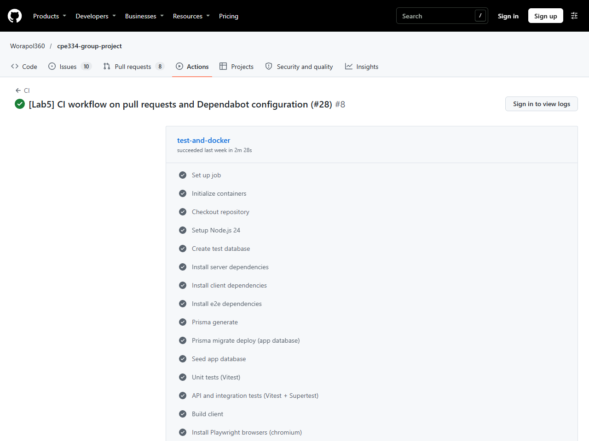

---

### 1.2 Keyless Workload Identity Federation (WIF)

**Design Document:** [`docs/labs/lab05/wif-and-merge-gate.md`](https://github.com/Worapol360/cpe334-group-project/blob/main/docs/labs/lab05/wif-and-merge-gate.md)

- **Zero JSON keys** — OpenID Connect (OIDC) token exchange replaces risky long-lived service account keys.
- **Deployer SA:** `s3ed50763-deployer@cpe-se-course-2026.iam.gserviceaccount.com` with least-privilege roles:
  - `roles/run.developer` (Cloud Run update/execute)
  - `roles/artifactregistry.writer` (scoped to repository `s3ed50763` only)
  - `roles/iam.serviceAccountUser` (actAs on runtime SA `s3ed50763-runner`)
- **WIF Pool & Provider:** `projects/670075229477/locations/global/workloadIdentityPools/s3ed50763/providers/s3ed50763`
- **Attribute Condition:** `assertion.repository == 'Worapol360/cpe334-group-project' && assertion.ref == 'refs/heads/main'`
- **Environment binding:** `principal://.../subject/repo:Worapol360/cpe334-group-project:environment:demo`

---

### 1.3 Required-Check Merge Gate — C-02 (R-06)

**Ruleset:** `protect-main-and-staging` (Active, enforced on `main` and `sprint1-staging`)
- Require pull request before merging (minimum 1 approval)
- Require status check `test-and-docker` to pass
- Require branches to be up to date; empty bypass list
- Secret scanning push protection enabled

**C-02 Demonstration — Failing test blocks merge:**
1. Created temporary branch `temp/lab5-failing-check` from `sprint1-staging`.
2. Added intentionally failing unit test in `server/tests/unit/lab5-gate-demo.test.js` (`expect(1 + 1).toBe(3)`).
3. Opened [PR #39 — `[Lab5][DEMO] Failing check must block merge (C-02)`](https://github.com/Worapol360/cpe334-group-project/pull/39).
4. Required check `test-and-docker` failed after 2m 41s ([Actions Run #45100536226](https://github.com/Worapol360/cpe334-group-project/actions/runs/45100536226)).
5. GitHub blocked the Merge button ("Required check failed").
6. PR #39 was closed without merging, keeping complete CI audit history.

**Figure 2. C-02 (R-06): Required status check `test-and-docker` failed on PR #39 from `temp/lab5-failing-check` after 2m 41s due to intentional unit assertion error. Commit d24ec7b**  
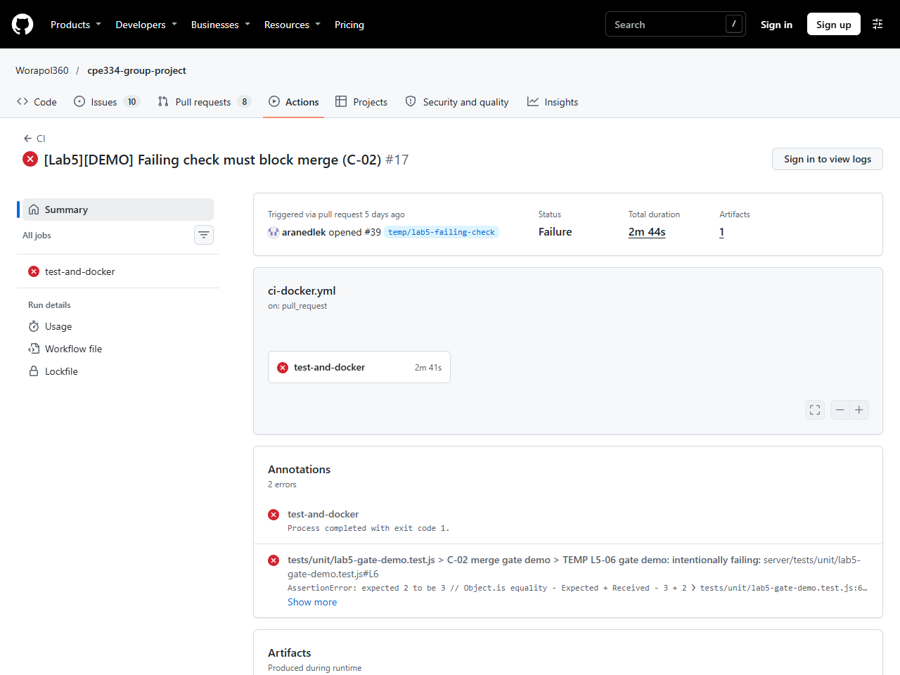

**Figure 3. C-02 (R-06): Intentional failing test in `server/tests/unit/lab5-gate-demo.test.js` triggering the merge gate block. Commit d24ec7b**  
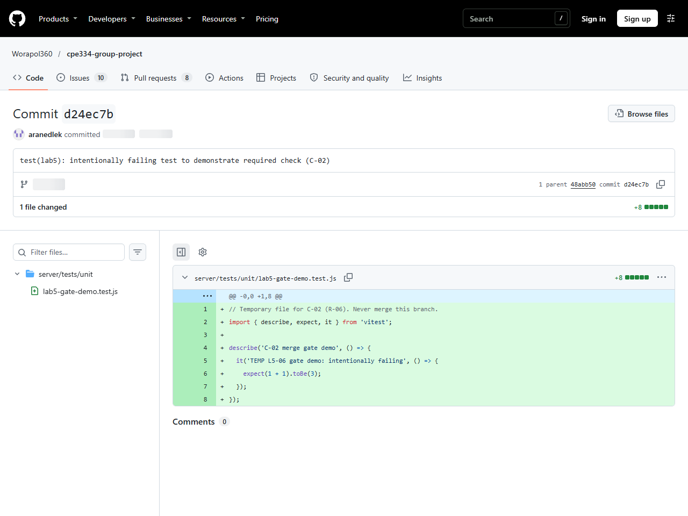

---

## Answer Part 2: Docker and Reproducible Configuration (20 Points)

### 2.1 Unified Production Container (`Dockerfile`) — C-03 (R-01, R-02)

**Dockerfile:** [`Dockerfile`](https://github.com/Worapol360/cpe334-group-project/blob/main/Dockerfile)  
Multi-stage build optimized for production:
1. **Client Build Stage (`client-builder`):** `node:24-alpine` → `npm ci` → `npm run build` → generates static assets in `client/dist`.
2. **Server Dependency Stage (`server-deps`):** `npm ci` → Prisma client code generation.
3. **Runtime Stage:** Copies server source and compiled client assets into an unprivileged environment running as non-root `node` on port `3000`.

**Key files:**
- [`Dockerfile`](https://github.com/Worapol360/cpe334-group-project/blob/main/Dockerfile) — unified multi-stage container
- [`docker-compose.yml`](https://github.com/Worapol360/cpe334-group-project/blob/main/docker-compose.yml) — local development environment with 4 services
- [`.dockerignore`](https://github.com/Worapol360/cpe334-group-project/blob/main/.dockerignore) — excludes unnecessary local files and secrets
- [`.env.example`](https://github.com/Worapol360/cpe334-group-project/blob/main/.env.example) — 14 environment variables with `CHANGE_ME` placeholders

---

### 2.2 Docker Compose Local Environment

| Service | Image | Port | Healthcheck / Readiness |
|---|---|---|---|
| `db` | `postgres:16-alpine` | `5433:5432` | `pg_isready` (named volume: `postgres_data`) |
| `migrate` | Build from root Dockerfile | — | Applies Prisma migrations and seed; exits code 0 |
| `server` | Build from root Dockerfile | `3000:3000` | Compose healthcheck verifies `GET /api/ready` |
| `client` | Build from root Dockerfile | `5173:80` | Production client bundle |

---

### 2.3 Verification Evidence (C-01 & C-03)

**Fresh Build Command:**
```powershell
docker compose --env-file server/.env up --build -d
```

**Container Status (`docker compose ps`):**
```text
NAME                   IMAGE                          SERVICE   STATUS                      PORTS
feedbackloop-client    cpe334-group-project-client    client    Up 14 seconds               0.0.0.0:5173->80/tcp
feedbackloop-db        postgres:16-alpine             db        Up 33 seconds (healthy)     0.0.0.0:5433->5432/tcp
feedbackloop-migrate   cpe334-group-project-migrate   migrate   Exited (0) 21 seconds ago   
feedbackloop-server    cpe334-group-project-server    server    Up 20 seconds (healthy)     0.0.0.0:3000->3000/tcp
```

**Local Probes (C-01):**
```text
GET /api/health → HTTP/1.1 200 OK → {"status":"ok","version":"dev"}
GET /api/ready  → HTTP/1.1 200 OK → {"status":"ready","db":"connected"}
```

**C-03 — Persistence Across Local Restart:**
```powershell
docker compose --env-file server/.env down
docker compose --env-file server/.env up -d
```
All surveys, seeded accounts, and responses persist intact in named volume `postgres_data` without re-seeding.

**Environment Variables Table (14 variables matching `.env.example`):**

| Name | Purpose | Secret | Where the value comes from |
|---|---|:---:|---|
| `APP_ENV` | Runtime environment: `development` \| `production` | no | local `.env`; Cloud Run env (`production`) |
| `PORT` | API listen port (local default `8081`) | no | local `.env`; Cloud Run env |
| `LOG_LEVEL` | Log verbosity | no | local `.env`; Cloud Run env |
| `APP_VERSION` | Version reported by `/api/health` | no | local `.env`; GitHub Actions / Cloud Run env |
| `CORS_ALLOWED_ORIGINS` | Allowed browser origins | no | local `.env`; Cloud Run env |
| `SESSION_TTL_MINUTES` | Session lifetime in minutes | no | local `.env`; Cloud Run env |
| `COOKIE_SECURE` | Session cookie `Secure` flag | no | local `.env`; Cloud Run env |
| `POSTGRES_USER` | Postgres superuser | no | local `server/.env`; Cloud SQL config |
| `POSTGRES_PASSWORD` | Postgres password | **yes** | local `server/.env`; Secret Manager |
| `POSTGRES_DB` | Database name | no | local `server/.env`; Cloud SQL config |
| `DATABASE_URL` | Application DB connection string | **yes** | local `server/.env`; Secret Manager |
| `DATABASE_URL_TEST` | Test DB connection string | **yes** | local `server/.env`; GitHub Actions throwaway |
| `SEED_PASSWORD` | Demo account password | **yes** | local `server/.env`; Secret Manager |
| `API_PROXY_TARGET` | Vite dev-server proxy target | no | local `.env` |

---

## Answer Part 3: GCP Deployment and Persistence (35 Points)

### 3.1 Provisioned Cloud Resources & Live Probes — C-04 (R-03)

Target project `cpe-se-course-2026`, region `asia-southeast1`, prefix `s3ed50763`:

| Resource | Name / Configuration |
|---|---|
| **Cloud Run Service** | `s3ed50763` — Public URL: https://s3ed50763-4d7hbszvwq-as.a.run.app |
| **Cloud Run Migration Job** | `s3ed50763-migrate` — executes `npx prisma migrate deploy && npm run prisma:seed` |
| **Cloud SQL PostgreSQL** | `s3ed50763-pg` — PostgreSQL 16 on `db-f1-micro` tier, 10 GB SSD |
| **Artifact Registry** | `asia-southeast1-docker.pkg.dev/cpe-se-course-2026/s3ed50763/s3ed50763` |
| **Secret Manager** | `s3ed50763-database-url`, `s3ed50763-admin-password`, `s3ed50763-demo-password` |
| **Runtime SA** | `s3ed50763-runner@cpe-se-course-2026.iam.gserviceaccount.com` |
| **Deployer SA** | `s3ed50763-deployer@cpe-se-course-2026.iam.gserviceaccount.com` (WIF only, no keys) |

**Live Verification Commands:**
```powershell
# Health probe
curl.exe -s https://s3ed50763-4d7hbszvwq-as.a.run.app/api/health
# Returns: {"status":"ok","version":"de6d5135183412346c59a10c90ff87383c77df21"}

# Readiness probe
curl.exe -s https://s3ed50763-4d7hbszvwq-as.a.run.app/api/ready
# Returns: {"status":"ready","db":"connected"}
```

**Figure 4. C-04 (R-03): Public Cloud Run login screen at live URL `https://s3ed50763-4d7hbszvwq-as.a.run.app/login` with running commit version in footer**  
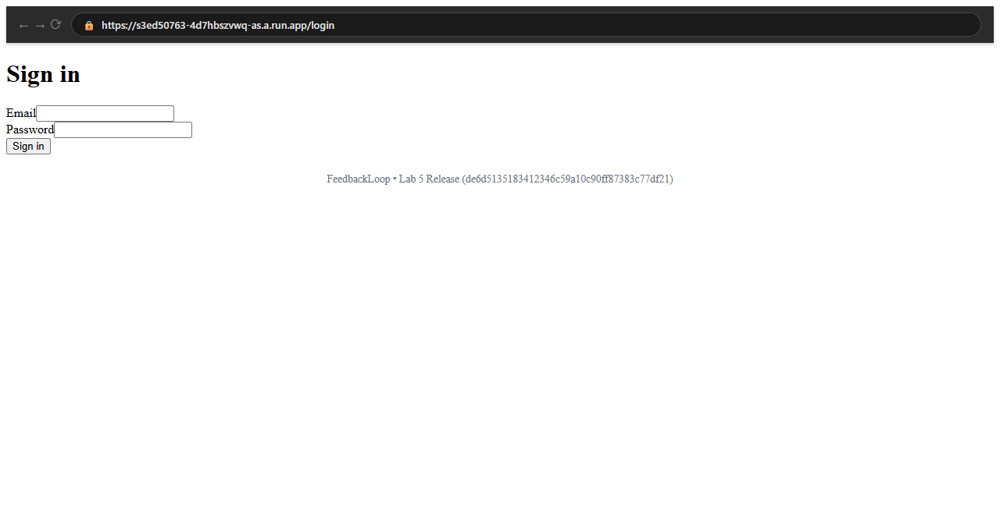

**Figure 5. C-04 (R-03): Domain rule rejection on live URL showing HTTP 401 invalid credentials error banner**  
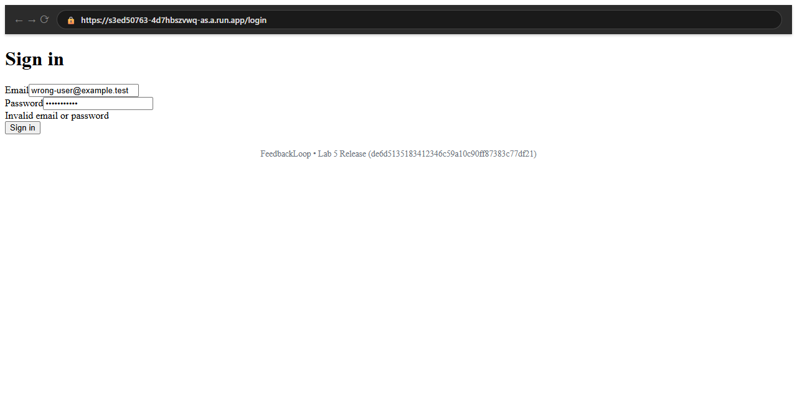

---

### 3.2 Cloud Persistence Verification — C-05 (R-04)

**Full Procedure Document:** [`docs/labs/lab05/persistence-test.md`](https://github.com/Worapol360/cpe334-group-project/blob/main/docs/labs/lab05/persistence-test.md)

1. **Step 1 — Create Identifiable Records (Live URL):**
   - Logged in as `owner1@example.test`, created survey **`Lab5 Persistence Test 7a705e2`** (Survey ID `5`), published it, and recorded `1` respondent response on revision `s3ed50763-00003-6dt` at `2026-11-24T00:24:32.958Z` (**Figure 6**).
2. **Step 2 — Cloud Run Restart (Same Image, New Revision):**
   - Updated env var `PERSISTENCE_TEST_AT` to trigger revision `s3ed50763-00004-ssd` (**Figure 7**).
   - Confirmed survey ID `5` and `1` response remained intact (**Figure 8**).
   - **Image Digest Proof:** Both revisions ran the **identical image digest** (`sha256:3002c8f30f2032ce97f30bd0cdc2ee2dd31982c98630a8a735385f4047c63461`), proving that restart changed only the revision, not the image.
3. **Step 3 — Pipeline Redeployment:**
   - Merged Release PR #49 into `main`, deploying commit `de6d513` via GitHub Actions Run #6 (**Figure 9**).
   - Verified `/api/health` returned new release commit `de6d5135183412346c59a10c90ff87383c77df21` (**Figure 10**).
   - Survey ID `5` and `1` response remained intact in Cloud SQL across complete pipeline redeployment.

**Figure 6. C-04 / C-05: Main domain business action on live URL showing owner survey summary (ID 5, 1 response) with address bar visible. Revision s3ed50763-00003-6dt; commit 7a705e2**  


**Figure 7. C-05 (R-04): Cloud Run revision update from 00003-6dt to 00004-ssd from the same image digest to simulate restart**  
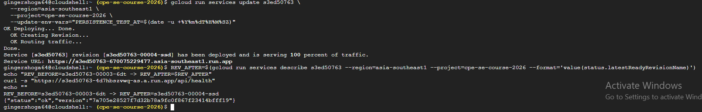

**Figure 8. C-05 (R-04): Owner summary after Cloud Run restart; survey ID 5 and 1 response intact with DevTools 200 fetch. Revision s3ed50763-00004-ssd; commit 7a705e2**  
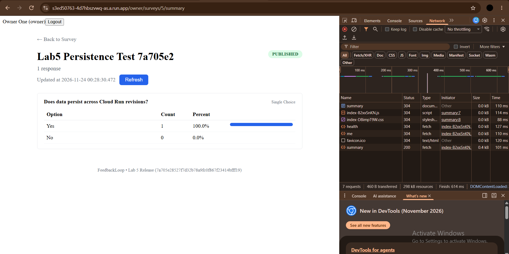

---

## Answer Part 4: Repeatable Release Pipeline (15 Points)

### 4.1 Automated Deployment Pipeline — C-06 (R-07 to R-10)

**Workflow File:** [`.github/workflows/deploy.yml`](https://github.com/Worapol360/cpe334-group-project/blob/main/.github/workflows/deploy.yml)  
**Release Script:** [`deploy/release.sh`](https://github.com/Worapol360/cpe334-group-project/blob/main/deploy/release.sh)  
**Smoke Test:** [`deploy/smoke_test.py`](https://github.com/Worapol360/cpe334-group-project/blob/main/deploy/smoke_test.py)  

**Lifecycle:** `Issue → Feature Branch → Feature PR (sprint1-staging) → Release PR (main) → Deploy`

1. **Pre-flight CI (`test`):** Re-runs `ci-docker.yml` (`test-and-docker`). If any test fails, deployment does not execute.
2. **Keyless Cloud Auth:** Authenticates via WIF (`google-github-actions/auth@v3`) using GitHub environment `demo`.
3. **Container Build & Registry Push:** Pushes root Dockerfile to Artifact Registry tagged with 40-character commit SHA (`$IMAGE_TAG`).
4. **Digest Pinning & Database Migration:** `release.sh` resolves image to immutable `@sha256:...` digest, executes Cloud Run migration job `s3ed50763-migrate` with `--wait`, and updates Cloud Run service `s3ed50763` with `--update-env-vars="APP_VERSION=$IMAGE_TAG"`.
5. **Post-Deployment Smoke Test:** `smoke_test.py` validates `/api/health` version, `/api/ready` DB status, root HTML, and authenticated session lifecycle (login, me, logout).
6. **Deployment Summary:** Records commit SHA, digest, rollback mode, service URL, and smoke results to `$GITHUB_STEP_SUMMARY`.

**Figure 9. C-06 (R-07, R-08): Deploy demo GitHub Actions Run #6 on `main`; commit de6d513; image digest; smoke test passed**  
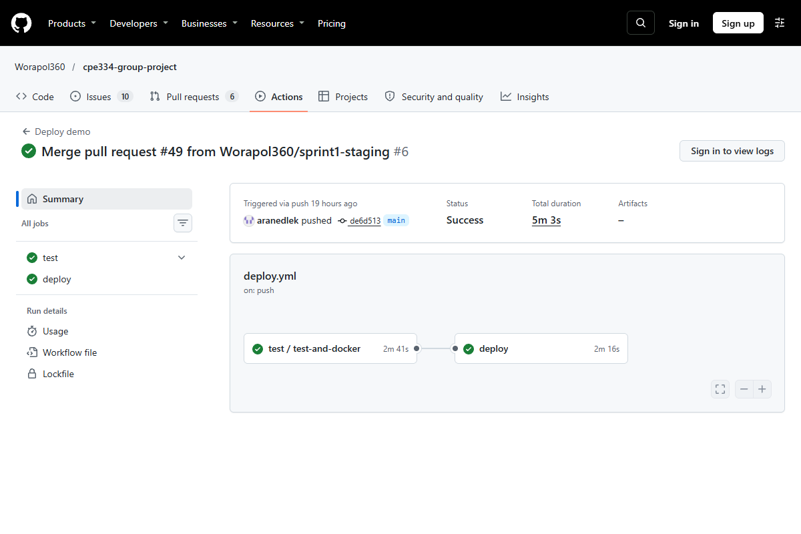

**Figure 10. C-06 (R-08): Public `/api/health` after pipeline redeploy returning deployed commit SHA `de6d5135183412346c59a10c90ff87383c77df21`**  
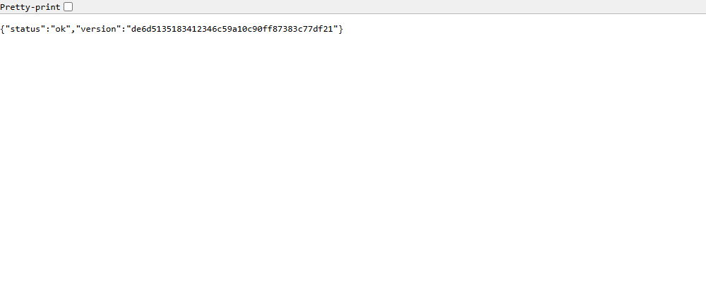

---

### 4.2 Rollback Procedure & Cost Control

- **Rollback:** GitHub Actions → **Deploy demo** → **Run workflow** → enter previous known-good commit SHA into `image_tag`. Tests, build, and migrations are skipped; Cloud Run shifts 100% traffic to the target digest image.
- **Cost Control:** Cloud Run configured with `min-instances: 0` (scales to zero) / `max-instances: 3`. Cloud SQL on tier `db-f1-micro` (10 GB SSD), paused via `gcloud sql instances patch s3ed50763-pg --activation-policy=NEVER` when idle to stop compute billing while retaining persistent data.

**Figure 11. R-09 & R-10: Complete GitHub Pull Request audit trail showing all Lab 5 PRs (#34–#41, #48–#49) labeled lab5, peer reviewed, and merged**  
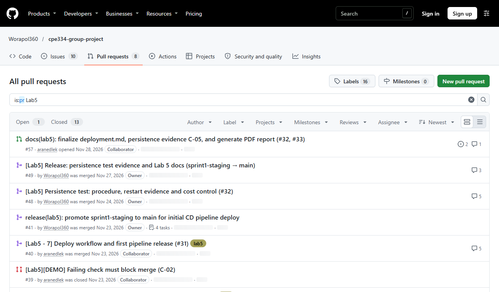

---

## Definition of Done Audit Checklist

- [x] **Every Lab 5 Issue and PR labelled `lab5`**: Confirmed across Issues #25–#33 and PRs #34–#41, #48–#49
- [x] **Every PR has specific peer review**: Verified with substantive review notes from @Worapol360 and @aranedlek
- [x] **Repository is public**: https://github.com/Worapol360/cpe334-group-project
- [x] **Zero secrets in repository, images, logs, or report**: No passwords, tokens, or private keys committed
- [x] **All Checks C-01 through C-06 fully verified and PASS**
- [x] **Deployment documentation complete**: [`docs/labs/lab05/deployment.md`](https://github.com/Worapol360/cpe334-group-project/blob/main/docs/labs/lab05/deployment.md)

**Figure 12. R-09 & R-10: Complete GitHub Issues audit trail showing all Lab 5 Issues (#25–#33) labeled lab5 and completed in Done state**  
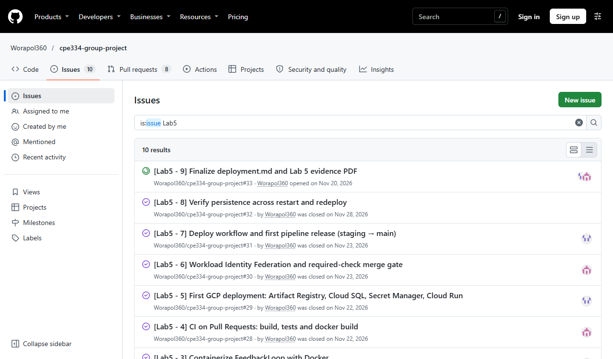

---

*Report compiled: November 2026*  
*Team: Worapol Saeku (67070501085) & Aran Edlek (67070505230) | Prefix: s3ed50763 | Section: 3*
