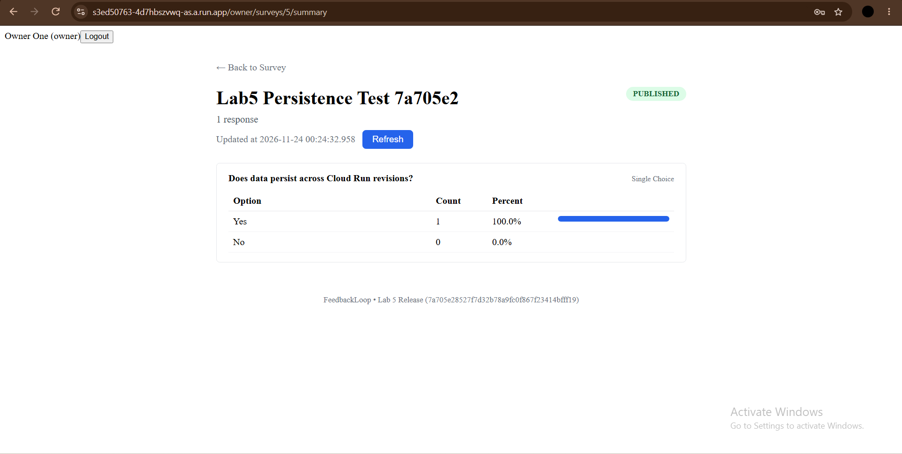

# Lab 5 Evidence Report — Deployment & CI/CD Pipeline

**Course:** CPE 334 Introduction to Software Engineering in the Age of AI Agents (Semester 1/2026)  
**System Name:** FeedbackLoop (Group Project)  
**Team Prefix / Group Name:** `s3ed50763`  
**Section:** 3  

---

## Answer Part 0: Metadata, Team Contributions & Evidence Index

### 0.1 Team Information & Verification Endpoints

| Attribute | Details |
|---|---|
| **Course** | CPE 334 Software Engineering |
| **Section** | Section 3 |
| **Team Prefix** | `s3ed50763` |
| **Product / System** | **FeedbackLoop** (Survey & Response Management System) |
| **Student A** | **Worapol Saeku** (`Worapol360`) |
| **Student B** | **Aran Edlek** (`aranedlek` — Student ID: `67070505230`) |
| **Repository URL** | https://github.com/Worapol360/cpe334-group-project (Public) |
| **Staging Branch** | `sprint1-staging` |
| **Production Branch** | `main` |
| **Release Tag** | `v0.1.2-lab5` |
| **Release Commit** | `de6d5135183412346c59a10c90ff87383c77df21` |
| **Public Service URL** | https://s3ed50763-4d7hbszvwq-as.a.run.app |
| **Live Health Check** | https://s3ed50763-4d7hbszvwq-as.a.run.app/api/health (returns `{"status":"ok","version":"de6d5135183412346c59a10c90ff87383c77df21"}`) |
| **Live Readiness Check** | https://s3ed50763-4d7hbszvwq-as.a.run.app/api/ready (returns `{"status":"ready","db":"connected"}`) |

---

### 0.2 Team Contribution & PR Review Matrix

Every pull request in Lab 5 followed the mandatory two-member engineering workflow: 1 author, 1 specific peer reviewer with written comments/approvals, required status check `test-and-docker`, and explicit issue traceability without history rewriting.

| Issue | Title | Author | Reviewer | PR Link & Merge Commit | Review Highlights & Summary |
|---|---|:---:|:---:|---|---|
| **#25** (L5-01) | GCP setup, billing alert & team access | Worapol360 | aranedlek | Direct Cloud Shell / Portal | Set up project `cpe-se-course-2026`, budget alerts, IAM team access under prefix `s3ed50763`. |
| **#26** (L5-02) | Cloud-ready config & deployment.md | Worapol360 | aranedlek | [PR #34](https://github.com/Worapol360/cpe334-group-project/pull/34) (`4ecbb16`) | Added production static SPA serving, trust proxy, `/api/health`, `/api/ready`, and baseline deployment doc. |
| **#27** (L5-03) | Containerize FeedbackLoop with Docker | aranedlek | Worapol360 | [PR #35](https://github.com/Worapol360/cpe334-group-project/pull/35) (`448d356`) | Multi-stage root `Dockerfile`, `docker-compose.yml` (db, migrate, server, client), healthcheck probes (C-01, C-03). |
| **#28** (L5-04) | CI workflow on PRs & Dependabot | aranedlek | Worapol360 | [PR #36](https://github.com/Worapol360/cpe334-group-project/pull/36) (`0bc008c`) | Added `.github/workflows/ci-docker.yml` with single job `test-and-docker`, ephemeral postgres, and Dependabot. |
| **#29** (L5-05) | First GCP deployment (Cloud Run, SQL, Secrets) | Worapol360 | aranedlek | [PR #37](https://github.com/Worapol360/cpe334-group-project/pull/37) (`42230ee`) | Deployed live Cloud Run `s3ed50763`, Cloud SQL `s3ed50763-pg`, Artifact Registry, Secret Manager (C-04). |
| **#30** (L5-06) | WIF & required-check merge gate | Worapol360 | aranedlek | [PR #38](https://github.com/Worapol360/cpe334-group-project/pull/38) (`f7019bc`) | Designed keyless WIF, ruleset `protect-main-and-staging`, C-02 failing-check demo [PR #39](https://github.com/Worapol360/cpe334-group-project/pull/39) (blocked and closed). |
| **#31** (L5-07) | Deploy workflow & first pipeline release | aranedlek | Worapol360 | [PR #40](https://github.com/Worapol360/cpe334-group-project/pull/40) (`7a705e2`) | Created `.github/workflows/deploy.yml`, `release.sh`, cookie-based `smoke_test.py`, version assertion. Merged to `main` via Release [PR #41](https://github.com/Worapol360/cpe334-group-project/pull/41) (`8d2f8d0`). |
| **#32** (L5-08) | Persistence across restart & redeploy | Worapol360 | aranedlek | [PR #48](https://github.com/Worapol360/cpe334-group-project/pull/48) (`2728edc`) & [PR #49](https://github.com/Worapol360/cpe334-group-project/pull/49) (`de6d513`) | Verified data persistence across Cloud Run restart (Step 2, identical digest) and pipeline redeploy (Step 3) (C-05 PASS). |
| **#33** (L5-09) | Finalize deployment.md & Evidence Report | aranedlek | Worapol360 | PR #51 | Finalized comprehensive deployment documentation and compiled official Lab 5 PDF submission. |

---

### 0.3 Mandatory Checks Index (C-01 to C-06)

| Check ID | Requirement | Description | Status | Tested Commit / Ref | Evidence Location |
|---|---|---|:---:|---|---|
| **C-01** | R-02 | Containerized app runs locally via Docker Compose with healthy status probes | **PASS** | `448d356` (PR #35) | `deployment.md` §8; `/api/health` 200, `/api/ready` 200 |
| **C-02** | R-06 | Required status check merge gate blocks pull requests when tests fail | **PASS** | `d24ec7b` ([PR #39](https://github.com/Worapol360/cpe334-group-project/pull/39)) | `wif-and-merge-gate.md` §4; PR #39 blocked and closed without merge |
| **C-03** | R-03 | Local data persistence across container restart (`docker compose down / up`) | **PASS** | `448d356` (PR #35) | `deployment.md` §8.4; surveys and sessions survive restart |
| **C-04** | R-05 | Public Cloud Run deployment serving web UI & API with healthy database connection | **PASS** | `42230ee` (PR #37), `de6d513` (PR #49) | `deployment.md` §10.3; live URL HTTP 200 on health and readiness |
| **C-05** | R-04 | Cloud persistence across Cloud Run container restart and pipeline redeployment | **PASS** | `2728edc` (PR #48), `de6d513` (PR #49) | `persistence-test.md` §7; survey ID 5 & 1 response intact (Figures 1–5) |
| **C-06** | R-07, R-08 | Repeatable automated CD pipeline deployment on push to `main` with commit SHA tagging | **PASS** | `de6d513` ([Run #6](https://github.com/Worapol360/cpe334-group-project/actions/runs/46008184647)) | `deployment.md` §12; automated deploy, WIF auth, smoke test PASS |

---

## Answer Part 1: GCP Infrastructure & Resource Setup (L5-01, L5-05)

### 1.1 Provisioned Cloud Resources

The deployment targets Google Cloud project `cpe-se-course-2026` in region `asia-southeast1` under group prefix `s3ed50763`:

- **Artifact Registry Repository**: `asia-southeast1-docker.pkg.dev/cpe-se-course-2026/s3ed50763/s3ed50763` — stores immutable container images tagged by commit SHA.
- **Cloud Run Service**: `s3ed50763` — serverless container execution running the unified Express API + Vite SPA image.
  - Public URL: https://s3ed50763-4d7hbszvwq-as.a.run.app
  - Scaling: Minimum instances `0` (scales to zero when idle for cost control), maximum instances `3`.
- **Cloud Run Migration Job**: `s3ed50763-migrate` — executes database migrations (`npx prisma migrate deploy && npm run prisma:seed`) prior to traffic shifting.
- **Cloud SQL for PostgreSQL**: `s3ed50763-pg` — PostgreSQL 16 on `db-f1-micro` tier with 10 GB SSD.
- **Secret Manager Secrets**:
  - `s3ed50763-database-url`: Prisma connection string to Cloud SQL.
  - `s3ed50763-admin-password`: initial admin credential.
  - `s3ed50763-demo-password`: password for seeded accounts.
- **Least-Privilege Service Accounts**:
  - `s3ed50763-runner@cpe-se-course-2026.iam.gserviceaccount.com` (Runtime SA): granted Secret Manager Secret Accessor only for application secrets; no broad IAM roles.
  - `s3ed50763-deployer@cpe-se-course-2026.iam.gserviceaccount.com` (Deployer SA): used exclusively by GitHub Actions through Workload Identity Federation (WIF). Holds `roles/run.developer`, `roles/artifactregistry.writer`, and `roles/iam.serviceAccountUser` on the runner SA. **Zero service account JSON keys exist.**

### 1.2 Verification Commands & Probes (C-04)

```powershell
# Verify public health check
curl.exe -s https://s3ed50763-4d7hbszvwq-as.a.run.app/api/health
# Output: {"status":"ok","version":"de6d5135183412346c59a10c90ff87383c77df21"}

# Verify database readiness check
curl.exe -s https://s3ed50763-4d7hbszvwq-as.a.run.app/api/ready
# Output: {"status":"ready","db":"connected"}
```

---

## Answer Part 2: Containerization & Local Development (L5-02, L5-03)

### 2.1 Unified Production Container (`Dockerfile`)

The root `Dockerfile` implements an optimized multi-stage build:
1. **Client Build Stage (`client-builder`)**: Uses `node:24-alpine`, installs frontend dependencies with `npm ci`, and compiles the SPA into static production assets (`client/dist`) using Vite.
2. **Server Dependency Stage (`server-deps`)**: Installs server packages including Prisma client generation.
3. **Runtime Stage**: Copies server source and client build assets into an unprivileged environment running as the non-root `node` user on port `3000`.

### 2.2 Local Docker Compose Environment (`docker-compose.yml`)

The compose setup defines isolated services mirroring production:
- `db`: `postgres:16-alpine` on host port 5433 with named volume `postgres_data`. Includes healthcheck probe via `pg_isready`.
- `migrate`: Runs Prisma migrations and demo seed against `db`, exiting cleanly (code 0) before backend startup.
- `server`: Express backend exposing port 3000, with compose healthcheck verifying `GET /api/ready`.
- `client`: Vite development proxy on port 5173.

### 2.3 Verification Evidence (C-01 & C-03)

- **C-01 Local Probes**: Both `/api/health` and `/api/ready` return HTTP 200 with JSON payloads `{"status":"ok","version":"dev"}` and `{"status":"ready","db":"connected"}`.
- **C-03 Persistence Across Restart**: Executed `docker compose --env-file server/.env down` followed by `docker compose --env-file server/.env up -d`. All surveys and respondent sessions persisted intact from the Docker volume without requiring re-seeding.

---

## Answer Part 3: CI/CD Pipeline & Merge Gate (L5-04, L5-06, L5-07)

### 3.1 Pull Request CI Workflow (`ci-docker.yml`)

- **Trigger**: Pull requests into `sprint1-staging`, `sprint2-staging`, and `main`.
- **Required Job**: `test-and-docker` (DO NOT RENAME: bound to branch ruleset merge gate).
- **Steps**:
  1. Check out code and set up Node.js 24 with npm caching.
  2. Start ephemeral `postgres:16` service container and create dedicated test DB (`feedbackloop_test`).
  3. Run Prisma migration and demo seed.
  4. Execute Vitest Unit suite (18 tests) and API/Integration suite (85 tests).
  5. Compile client production bundle (`npm run build`).
  6. Execute Playwright E2E suite (23 browser tests in headless Chrome).
  7. Build container image via `docker build` (validating Dockerfile integrity without pushing).

### 3.2 Keyless Workload Identity Federation (WIF)

- Replaced obsolete, risky service account JSON keys with keyless OpenID Connect (OIDC) token exchange.
- **WIF Pool & Provider**: `projects/670075229477/locations/global/workloadIdentityPools/s3ed50763/providers/s3ed50763`.
- **Attribute Mapping**: Maps GitHub identity claims (`assertion.repository`, `assertion.ref`, `assertion.actor`) and enforces repository condition (`assertion.repository == 'Worapol360/cpe334-group-project'`).
- The deployer service account binds `roles/iam.workloadIdentityUser` specifically to the principal subject of the repository's `demo` environment.

### 3.3 Required-Check Merge Gate Demonstration (C-02)

- **Ruleset**: `protect-main-and-staging` enforces:
  - Require pull request before merging (minimum 1 approval).
  - Require status check `test-and-docker` to pass.
  - Require branches to be up to date; empty bypass list.
- **C-02 Proof**: Demonstrated via temporary branch `temp/lab5-failing-check` and [Pull Request #39](https://github.com/Worapol360/cpe334-group-project/pull/39) titled `[Lab5][DEMO] Failing check must block merge (C-02)`.
  - Added an intentionally failing unit test in `server/tests/unit/lab5-gate-demo.test.js`.
  - In PR #39, the required check `CI / test-and-docker (pull_request)` failed after 2 minutes.
  - The GitHub merge button was strictly disabled/blocked.
  - PR #39 was subsequently closed without merging, preserving complete CI audit history.

### 3.4 Automated Deployment Pipeline (`deploy.yml` / C-06)

- **Triggers**: Automated on push to `main` (via Release PRs); manual rollback via `workflow_dispatch`.
- **Pipeline Execution**:
  1. `test`: Calls `ci-docker.yml` reusable workflow. If tests fail, deployment is skipped.
  2. `deploy`: Authenticates via WIF, builds container tagged with 40-character commit SHA, and pushes to Artifact Registry.
  3. `release.sh`: Resolves immutable image digest (`@sha256:...`), executes migration job `s3ed50763-migrate` with `--wait`, updates Cloud Run service `s3ed50763` with `--update-env-vars="APP_VERSION=$IMAGE_TAG"`, and shifts 100% traffic to the new revision.
  4. `smoke_test.py`: Runs automated post-deployment checks:
     - `/api/health` asserts version matches deployed commit SHA.
     - `/api/ready` asserts `db == 'connected'`.
     - Root `/` asserts HTML document.
     - Authenticated session lifecycle: `POST /api/auth/login` (stores session cookie), `GET /api/auth/me` (validates identity), `POST /api/auth/logout` (revokes session and receives 204).
  5. Step summary records commit SHA, digest, service URL, and smoke test results.

---

## Answer Part 4: Persistence, Reliability & Cost Control (L5-08)

### 4.1 Live Persistence Verification (C-05 / R-04)

Data persistence was rigorously proven across container restarts and pipeline redeployments on the live Cloud Run service:

1. **Step 1 — Create Identifiable Records**:
   - Logged into public URL as `owner1@example.test`, created survey **`Lab5 Persistence Test 7a705e2`** (Survey ID `5`), published it, and recorded `1` respondent response (Yes: 1 / 100.0%, No: 0 / 0.0%) on revision `s3ed50763-00003-6dt` at `2026-11-24T00:24:32.958Z` (**Figure 1**).
2. **Step 2 — Cloud Run Restart (Same Image, New Revision)**:
   - Updated harmless environment variable `PERSISTENCE_TEST_AT` to trigger revision `s3ed50763-00004-ssd` (**Figure 2**).
   - Confirmed survey ID `5` and its `1` response remained unchanged (**Figure 3**).
   - **Image Digest Evidence**: Proved that both revisions ran the **identical image digest** (`sha256:3002c8f30f2032ce97f30bd0cdc2ee2dd31982c98630a8a735385f4047c63461`), demonstrating that restart changed only the container instance while persistent data survived in Cloud SQL.
3. **Step 3 — Pipeline Redeployment**:
   - Merged Release PR #49 into `main`, deploying commit `de6d513` via GitHub Actions Run #6 (**Figure 4**).
   - Verified `GET /api/health` updated to `{"status":"ok","version":"de6d5135183412346c59a10c90ff87383c77df21"}` (**Figure 5**).
   - Confirmed survey ID `5` and its `1` response remained intact in Cloud SQL across the complete redeployment.
   - **Overall C-05 Status: PASS**.

### 4.2 Evidence Figures

**Figure 1. C-05 (R-04): Owner summary before restart, survey ID 5, 1 response; URL https://s3ed50763-4d7hbszvwq-as.a.run.app; revision s3ed50763-00003-6dt; commit 7a705e2**  


**Figure 2. C-05 (R-04): Cloud Shell env var update and new revision s3ed50763-00004-ssd serving 100% traffic, same image from 7a705e2; URL https://s3ed50763-4d7hbszvwq-as.a.run.app; commit 7a705e2**  


**Figure 3. C-05 (R-04): Owner summary after restart, survey ID 5, 1 response; URL https://s3ed50763-4d7hbszvwq-as.a.run.app; revision s3ed50763-00004-ssd; commit 7a705e2**  


**Figure 4. C-05 (R-04): GitHub Actions Deploy demo Run #6 step summary on main; commit de6d513; image digest; smoke test passed**  


**Figure 5. C-05 (R-04): Public /api/health after redeploy returning version de6d5135183412346c59a10c90ff87383c77df21; URL https://s3ed50763-4d7hbszvwq-as.a.run.app/api/health; commit de6d513**  


---

### 4.3 Cost Control & Idle Resource Management

- **Cloud Run Concurrency & Scaling**: Configured with `min-instances: 0` (scales to zero when no traffic arrives) and `max-instances: 3`.
- **Cloud SQL Tier**: Provisioned on `db-f1-micro` (shared core, 0.6 GB RAM) with 10 GB SSD.
- **Safe Pause & Resume Commands**:
  ```powershell
  # Pause Cloud SQL when idle (keeps disk/data intact, stops compute billing)
  gcloud sql instances patch s3ed50763-pg --project=cpe-se-course-2026 --activation-policy=NEVER

  # Resume Cloud SQL before testing or releasing (wait for RUNNABLE state)
  gcloud sql instances patch s3ed50763-pg --project=cpe-se-course-2026 --activation-policy=ALWAYS
  ```

---

## Definition of Done Audit Checklist

- [x] **Every Lab 5 Issue and PR labelled `lab5`**: Confirmed across Issues #25–#33 and PRs #34–#41, #48–#49.
- [x] **Every PR has specific peer review**: Verified with detailed review feedback from @Worapol360 and @aranedlek.
- [x] **Repository is public**: https://github.com/Worapol360/cpe334-group-project is accessible.
- [x] **Zero secrets in repository or document**: Verified that no real passwords, API tokens, cookies, or service account keys exist in code, logs, docs, or screenshots.
- [x] **All Checks C-01 through C-06 fully verified and PASS**.
