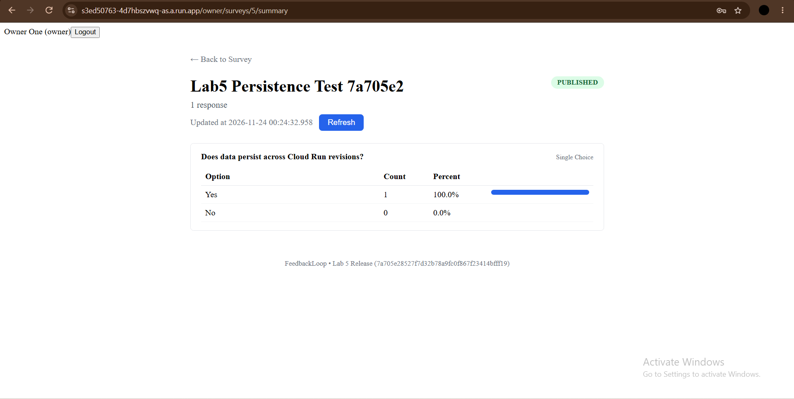
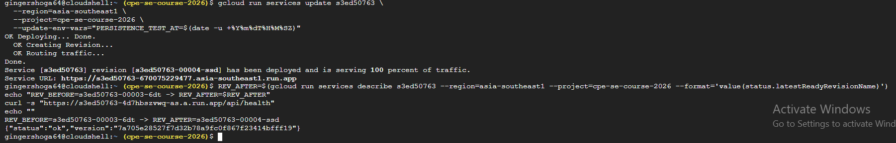
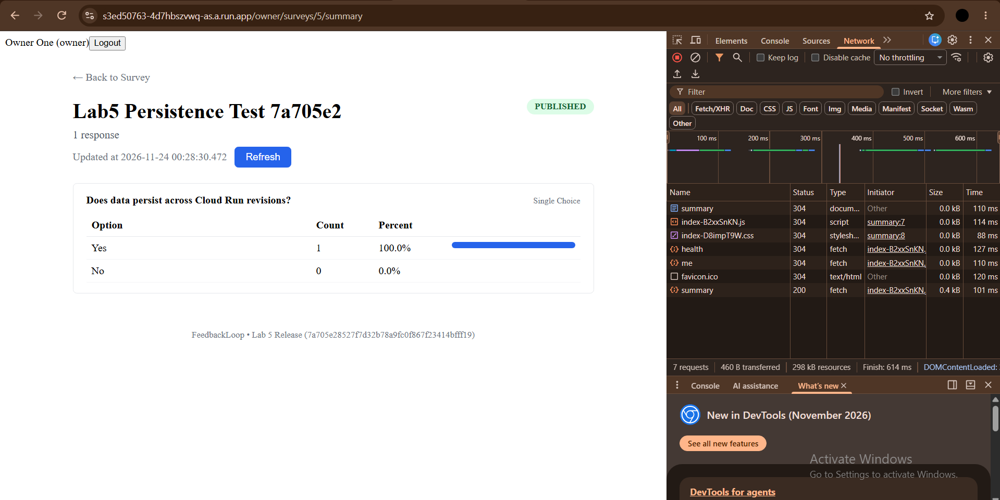

# Persistence test procedure and evidence — C-05 (R-04) / Issue L5-08

**Status: PARTIAL — Step 1 = DONE, Step 2 (restart) = PASS, Step 3 (redeploy) = PENDING; overall C-05 = PARTIAL (restart proven, redeploy pending).**

## 1. Goal and pass criteria

Prove **R-04** / check **C-05**: application data (surveys, responses) and server-side sessions live in Cloud SQL, not in the container, so they survive a Cloud Run restart (Step 2), a pipeline redeploy (Step 3) and an optional rollback/roll-forward (Step 4).

**Pass** when, after each of Steps 2–4:

- the records created in Step 1 still exist with unchanged counts,
- the owner opens the summary and sees the same response count,
- the pre-existing session still works, **or** login works again if the session TTL expired (TTL expired is an accepted fallback, note the times),
- after a redeploy, `GET /api/health` returns `version` equal to the new commit SHA,
- **Step 2 only:** the image digest read before and after the restart is **identical** (restart changed only the revision, not the image).

## 2. Preconditions

- Public URL: `https://s3ed50763-4d7hbszvwq-as.a.run.app`
- A demo **owner** account and a demo **respondent** account. Passwords are shared privately between team members and must **never** be written in this file, any doc, or any screenshot.
- **Session TTL**: `SESSION_TTL_MINUTES`, default **60** minutes (`server/src/config.js`). Run the before/after login checks within one TTL window; if it expired, fall back to "login works again" and record the times.
- Cloud SQL instance `s3ed50763-pg` must be **RUNNING** before starting (see §8).
- Both members have read the cost-control section (§8) before running any state-changing command.
- Command markers: **[CHANGES SERVICE]** / **[CHANGES STATE]** alter cloud state; all other commands are read-only. Nothing here is run by the agent — a human runs them.

## 3. Step 1 — Create identifiable records (live URL)

1. As the **owner**, log in on the public URL, create a survey with a distinctive title: `L5-08 persistence <YYYY-MM-DD HH:MM>` (local time). *(Actual run title: `Lab5 Persistence Test 7a705e2`.)*
2. Add at least one question and **publish** the survey.
3. As the **respondent**, log in and submit **one** response.
4. As the **owner**, open the survey **summary** and note the response count.
5. Record the run — **Step 1 = DONE** (real run of 2026-11-24):

| Field | Value |
|---|---|
| Survey title | `Lab5 Persistence Test 7a705e2` |
| Survey ID | `5` |
| Response count | `1` (Yes: 1 / 100.0%, No: 0 / 0.0%) |
| Owner account used | `owner1@example.test` (password never recorded) |
| Time (UTC, ISO) | `2026-11-24T00:24:32.958Z` (page "Updated at 2026-11-24 00:24:32.958") |
| `/api/health` version | `7a705e28527f7d32b78a9fc0f867f23414bfff19` |
| Current Cloud Run revision | `s3ed50763-00003-6dt` |

**Figure 1. C-05 (R-04): Owner summary before restart, survey ID 5, 1 response; URL https://s3ed50763-4d7hbszvwq-as.a.run.app; revision s3ed50763-00003-6dt; commit 7a705e2**



Read-only commands.

**Terminal: PowerShell**

```powershell
# Purpose: record the running version before the test
curl.exe -s https://s3ed50763-4d7hbszvwq-as.a.run.app/api/health
```

**Terminal: PowerShell**

```powershell
# Purpose: record the revision serving before the test
gcloud run services describe s3ed50763 --region=asia-southeast1 --project=cpe-se-course-2026 --format="value(status.latestReadyRevisionName)"
```

## 4. Step 2 — Restart (new Cloud Run revision, same image)

Force a fresh container **without changing the image** by updating a harmless env var (restart marker). Numbered command pack for a human:

**Terminal: PowerShell**

```powershell
# 1. Purpose: confirm the image digest currently deployed (baseline, read-only)
gcloud run revisions describe s3ed50763-00003-6dt --region=asia-southeast1 --project=cpe-se-course-2026 --format="value(spec.template.spec.containers[0].image)"
```

**Terminal: PowerShell**

```powershell
# 2. Purpose: force a NEW revision from the same image via a harmless env var
# [CHANGES SERVICE] — creates a revision and shifts traffic to it
gcloud run services update s3ed50763 --region=asia-southeast1 --project=cpe-se-course-2026 --update-env-vars="RESTART_MARKER=persistence-<YYYYMMDD-HHMM>"
```

**Terminal: PowerShell**

```powershell
# 3. Purpose: confirm the new revision is serving 100% of traffic (read-only)
gcloud run services describe s3ed50763 --region=asia-southeast1 --project=cpe-se-course-2026 --format="table(status.latestReadyRevisionName, status.traffic.revisionName, status.traffic.percent, status.traffic.latestRevision)"
```

**Terminal: PowerShell**

```powershell
# 4. Purpose: list revisions (read-only) — keep the new revision name for evidence
gcloud run revisions list --service=s3ed50763 --region=asia-southeast1 --project=cpe-se-course-2026
```

**Terminal: PowerShell**

```powershell
# 5. Purpose: verify the new revision runs the SAME image digest (read-only)
gcloud run revisions describe <new-revision-name> --region=asia-southeast1 --project=cpe-se-course-2026 --format="value(spec.template.spec.containers[0].image)"
```

**Observe scale to zero** (read-only, time-dependent): leave the service idle ~10 minutes, then in Console → Cloud Run `s3ed50763` → **Metrics** confirm *Container instance count* = 0 (min instances is 0). The next request cold-starts (slower first response). No command changes anything here.

**Actual restart trigger used (Step 2 = PASS):**

**Terminal: Cloud Shell (Bash)** — this is the variant that was actually run:

```bash
# [CHANGES SERVICE] Purpose: force a new revision from the same image via a restart marker env var
gcloud run services update s3ed50763 --region=asia-southeast1 --project=cpe-se-course-2026 --update-env-vars="PERSISTENCE_TEST_AT=$(date -u +%Y%m%dT%H%M%SZ)"
```

**Terminal: PowerShell** — equivalent, same meaning, if run from a Windows terminal:

```powershell
# [CHANGES SERVICE] Purpose: force a new revision from the same image via a restart marker env var
$ts = (Get-Date).ToUniversalTime().ToString("yyyyMMddTHHmmssZ")
gcloud run services update s3ed50763 --region=asia-southeast1 --project=cpe-se-course-2026 --update-env-vars="PERSISTENCE_TEST_AT=$ts"
```

> **Note:** `PERSISTENCE_TEST_AT` is a harmless restart marker env var that forces a new revision. The application does not read it; it is not in `.env.example`; it remains set on the service.

**Figure 2. C-05 (R-04): Cloud Shell env var update and new revision s3ed50763-00004-ssd serving 100% traffic, same image from 7a705e2; URL https://s3ed50763-4d7hbszvwq-as.a.run.app; commit 7a705e2**



**Verify after restart:** (recorded 2026-11-24T00:28:30.472Z)

1. `/api/health` still 200 → `{"status":"ok","version":"7a705e28527f7d32b78a9fc0f867f23414bfff19"}` (unchanged SHA).
2. Owner session on `owner1@example.test` still worked within the 60-minute TTL; the summary shows the same title, **survey ID 5**, **1 response**; `GET /api/surveys/5/summary` returned 200 after refresh (DevTools "200 fetch").
3. New revision `s3ed50763-00004-ssd` serving 100% traffic, same image from 7a705e2.
4. **Image digest comparison (Step 2 pass criterion):** the read-only command below returned the **identical** image digest for both revisions — **identical digest: restart changed only the revision, not the image** (evidence table below).

**Figure 3. C-05 (R-04): Owner summary after restart, survey ID 5, 1 response; URL https://s3ed50763-4d7hbszvwq-as.a.run.app; revision s3ed50763-00004-ssd; commit 7a705e2**



**Image digest evidence (Step 2 pass criterion) — read-only, Terminal: Cloud Shell (Bash)** (run by a human in Cloud Shell):

```bash
# Purpose: read-only — read the image reference and digest for both revisions (no state change)
gcloud run revisions describe s3ed50763-00003-6dt --region=asia-southeast1 --project=cpe-se-course-2026 --format="value(spec.containers[0].image, status.imageDigest)"
gcloud run revisions describe s3ed50763-00004-ssd --region=asia-southeast1 --project=cpe-se-course-2026 --format="value(spec.containers[0].image, status.imageDigest)"
```

| Revision | Image digest | Result |
|---|---|---|
| `s3ed50763-00003-6dt` (before restart) | `sha256:3002c8f30f2032ce97f30bd0cdc2ee2dd31982c98630a8a735385f4047c63461` | baseline |
| `s3ed50763-00004-ssd` (after restart) | `sha256:3002c8f30f2032ce97f30bd0cdc2ee2dd31982c98630a8a735385f4047c63461` | **identical** |

**Conclusion:** identical digest: restart changed only the revision, not the image. Both revisions reference the image `asia-southeast1-docker.pkg.dev/cpe-se-course-2026/s3ed50763/s3ed50763@sha256:3002c8f30f2032ce97f30bd0cdc2ee2dd31982c98630a8a735385f4047c63461`.

## 5. Step 3 — Redeploy through the pipeline

**Status: PENDING.** It will be executed through the next release PR to `main` and recorded later as **Figure 4** (deploy run step summary) and **Figure 5** (`/api/health` after redeploy).

**Trigger** — `deploy.yml` supports `workflow_dispatch`, so:

- **Manual (preferred for the test):** GitHub → Actions → **Deploy demo** → **Run workflow** → branch `main`, `image_tag` **left empty** (empty = test, build and deploy current `main`). [via GitHub UI]
- **Otherwise:** a normal release PR `sprint1-staging` → `main`; merging triggers the same pipeline on push.

**What to check in the run:**

1. Job `test` ran the CI workflow (`test-and-docker`) and passed — deploy is skipped if it fails.
2. Image tag = full 40-character commit SHA (validate step rejects anything else).
3. Step summary shows the image **digest** (`@sha256:...`), `Rollback: false`, service URL.
4. Migration job `s3ed50763-migrate` executed with `--wait` and succeeded (prereq: Cloud SQL RUNNING).
5. Smoke test passed: `/api/health` version == IMAGE_TAG, `/api/ready` DB connected, `/` HTML, plus login/`/api/auth/me`/logout if `SMOKE_EMAIL`/`SMOKE_PASSWORD` are configured.

**Verify after redeploy:** repeat the Step 2 verification (records exist, summary counts unchanged, session works or re-login), then:

**Terminal: PowerShell**

```powershell
# Purpose: version must equal the new commit SHA (read-only)
curl.exe -s https://s3ed50763-4d7hbszvwq-as.a.run.app/api/health
```

## 6. Step 4 (optional) — Rollback and roll forward  **[OPTIONAL]**

> **Safety:** this is only safe if migrations are **additive** (no destructive/irreversible schema change), so an older image can still run against the current database.

- **Option A — via the workflow [CHANGES SERVICE]:** Deploy demo → Run workflow → branch `main`, `image_tag` = full 40-char SHA of a previous known-good commit. Tests, build and migration are skipped; the service is pointed back at that image and the smoke test runs.
- **Option B — route traffic to an earlier revision [CHANGES SERVICE]:**

**Terminal: PowerShell**

```powershell
# Purpose: send 100% of traffic to an earlier revision (read the name from revisions list first)
gcloud run services update-traffic s3ed50763 --to-revisions=<earlier-revision>=100 --region=asia-southeast1 --project=cpe-se-course-2026
```

- **Smoke check:** `/api/health` (read-only curl), owner login, summary counts unchanged.
- **Roll forward [CHANGES SERVICE]:** re-run Deploy demo with the newer SHA, or:

**Terminal: PowerShell**

```powershell
# Purpose: send 100% of traffic back to the latest revision
gcloud run services update-traffic s3ed50763 --to-latest --region=asia-southeast1 --project=cpe-se-course-2026
```

## 7. Evidence table

Release under test: commit `7a705e28527f7d32b78a9fc0f867f23414bfff19`. Service `s3ed50763`, region `asia-southeast1`, project `cpe-se-course-2026`.

| Check | Before (time, revision, version) | After restart | After redeploy | Result | Screenshot figure |
|---|---|---|---|---|---|
| Distinctive survey `Lab5 Persistence Test 7a705e2` (ID 5) exists | `2026-11-24T00:24:32.958Z`, `s3ed50763-00003-6dt`, survey ID `5` | `2026-11-24T00:28:30.472Z`, `s3ed50763-00004-ssd`, survey ID `5` unchanged | PENDING | Step 1 = DONE; Step 2 = PASS; Step 3 = PENDING | Figure 1 / 3 |
| Response count unchanged (owner summary) | `1` (Yes: 1 / 100.0%, No: 0 / 0.0%) | `1` (unchanged) | PENDING | Step 1 = DONE; Step 2 = PASS; Step 3 = PENDING | Figure 1 / 3 |
| Session works (or re-login works) | owner `owner1@example.test` logged in (password never recorded) | session still worked within the 60-minute TTL | PENDING | Step 2 = PASS | — |
| `/api/health` version | `7a705e28527f7d32b78a9fc0f867f23414bfff19` | `{"status":"ok","version":"7a705e28527f7d32b78a9fc0f867f23414bfff19"}` (unchanged) | PENDING (must equal new SHA) | Step 2 = PASS; Step 3 = PENDING | Figure 5 (PENDING) |
| New revision serving 100% traffic / same image digest | `s3ed50763-00003-6dt` | `s3ed50763-00004-ssd`, 100% traffic, same image from `7a705e2` | PENDING | Step 2 = PASS; Step 3 = PENDING | Figure 2 / 4 |
| Image digest identical before/after restart (Step 2 pass criterion) | `s3ed50763-00003-6dt`: `sha256:3002c8f30f2032ce97f30bd0cdc2ee2dd31982c98630a8a735385f4047c63461` | `s3ed50763-00004-ssd`: `sha256:3002c8f30f2032ce97f30bd0cdc2ee2dd31982c98630a8a735385f4047c63461` — **identical digest: restart changed only the revision, not the image** | PENDING (new SHA expected) | Step 2 = PASS; Step 3 = PENDING | — |
| Rollback + roll forward records intact (optional) | — | — | PENDING | not run (optional) | — |

**Overall C-05 = PARTIAL (restart proven, redeploy pending).** The "After redeploy" column stays **PENDING**; Figures 4 and 5 will be added after the release PR.

**Screenshots to take** (URL bar visible, revision/time visible, **no secrets** — no passwords, cookies, connection strings, or env values):

1. ✅ Taken — Figure 1: owner summary with the distinctive title and response counts (public URL visible).
2. ✅ Taken — Figure 2: revision update showing the new revision at 100% traffic, with timestamp.
3. ✅ Taken — Figure 3: the same owner summary **after** the restart.
4. ⬜ PENDING — Figure 4: the Deploy demo run step summary (commit SHA, digest, smoke test passed).
5. ⬜ PENDING — Figure 5: `/api/health` output **after** the redeploy (`version` = new commit SHA).

**Caption format:** `Figure N. C-05 (R-04): <what> ; <URL>; <revision>; <commit>`

## 8. Cost control

Target settings (as provisioned by `deploy/deploy.sh`): Cloud Run **min instances 0**, **max instances 3**; Cloud SQL tier **`db-f1-micro`** (smallest).

Read-only checks.

**Terminal: PowerShell**

```powershell
# Purpose: read min/max instances (read-only)
gcloud run services describe s3ed50763 --region=asia-southeast1 --project=cpe-se-course-2026 --format="value(spec.template.spec.scaling.minInstanceCount, spec.template.spec.scaling.maxInstanceCount)"
```

**Terminal: PowerShell**

```powershell
# Purpose: read Cloud SQL tier and activation policy (read-only)
gcloud sql instances describe s3ed50763-pg --project=cpe-se-course-2026 --format="value(settings.tier, settings.activationPolicy)"
```

Pause / resume Cloud SQL — **[CHANGES STATE] — both members must read this block before running either command:**

**Terminal: PowerShell** — [CHANGES STATE]

```powershell
# [CHANGES STATE] Purpose: pause Cloud SQL when idle — stopping (activation policy NEVER) does NOT delete data; the persistent disk/storage is kept
gcloud sql instances patch s3ed50763-pg --project=cpe-se-course-2026 --activation-policy=NEVER
```

**Terminal: PowerShell** — [CHANGES STATE]

```powershell
# [CHANGES STATE] Purpose: resume Cloud SQL — the instance MUST be resumed (activation policy ALWAYS) and confirmed running before every test and before every deploy/release (the migration job and the app need it)
gcloud sql instances patch s3ed50763-pg --project=cpe-se-course-2026 --activation-policy=ALWAYS
```

Read-only check of the instance state — run it after resume and before every test and every deploy/release:

**Terminal: PowerShell**

```powershell
# Purpose: read-only instance state check — expect settings.activationPolicy=ALWAYS and status=RUNNABLE before any test or deploy/release
gcloud sql instances describe s3ed50763-pg --project=cpe-se-course-2026 --format="value(settings.activationPolicy, status)"
```

**Warnings:**

- Stopping (`activationPolicy = NEVER`) does **not** delete data and does **not** delete storage: the instance is stopped and its persistent disk is kept. Only deleting the instance would remove them.
- The instance MUST be resumed (`activationPolicy = ALWAYS`) and **confirmed running** with the read-only check above (`ALWAYS` / `RUNNABLE`) before **every** test and before **every** deploy/release — the migration job `s3ed50763-migrate` and the app both need the database; otherwise they fail.
- Both pause and resume are **[CHANGES STATE]** commands: both members must read this block before either command is run.

## 9. Known limitations

- A pass proves persistence only for the records created in Step 1 at the times measured — not for every feature or data type.
- Seeded demo data is recreated by `prisma:seed` on every migration job run, so seeded rows are **not** reliable evidence; use the distinctive UI-created record.
- The session check is bounded by the 60-minute TTL: "login works again" is an accepted fallback, not proof the original session survived.
- Step 2 changes an env var, so the new revision is not byte-identical configuration-wise; the image digest staying the same is what proves "same image".
- Scale-to-zero observation depends on the idle window and the Console metrics view.
