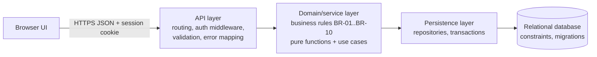
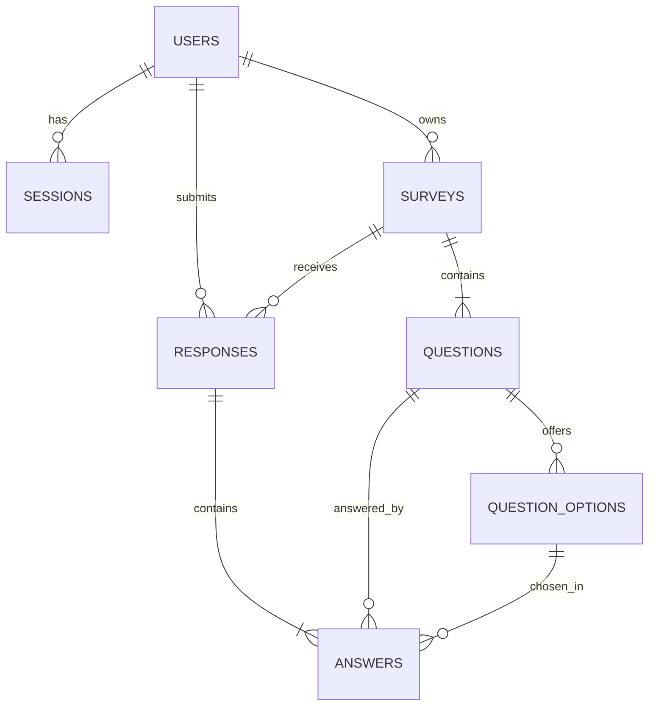

# System-Level Software Design Specification (SDS)

Version v0.1 – 2026-11-10. Stack-neutral design: fill the `⟨TBD⟩` fields in §2 once Q-01 (stack) is resolved. Nothing else in this document depends on the stack.

## 1. Overview

FeedbackLoop is a modular monolith: a web UI, an HTTP/JSON API with an application/domain layer, and a relational database. All business rules live in the domain layer and are backed by database constraints.

## 2. Technology stack (to be recorded before F-01 starts)

| Layer | Choice | Reason |
|---|---|---|
| Language/runtime | ⟨TBD⟩ | |
| UI | ⟨TBD⟩ (SPA or server-rendered) | |
| API framework | ⟨TBD⟩ | |
| ORM / migration tool | ⟨TBD⟩ | |
| Database | ⟨TBD, relational with unique constraints + transactions; PostgreSQL recommended for GCP Cloud SQL⟩ | |
| Password hashing library | ⟨TBD, argon2id or bcrypt⟩ | |
| Unit / API tests | ⟨TBD⟩ | |
| E2E tests | ⟨TBD⟩ | |

**Stack requirements** (any stack must satisfy): server-side sessions with HttpOnly cookies; DB transactions; DB unique/check/foreign-key constraints; a way to run migrations and seed from the command line; a test runner that can start the API against a test database; configuration from environment variables; buildable into one container image.

**Adaptation note:** the Lab 5 starter kit assumes Node 24, React, Express, PostgreSQL and Prisma. If the group stack differs, only §2 and the Lab 5 files change.

## 3. Architecture



| Component | Responsibility |
|---|---|
| UI | Screens, client-side validation (convenience only), route guards (convenience only), calls the API |
| API layer | Parse request, authenticate session, authorize role/ownership, validate shape, call use case, map errors to the error envelope |
| Domain layer | Rules: survey validity (BR-05), state transitions (BR-03/04), response validity (BR-06), aggregation (FR-11). Free of HTTP and DB code, so it is unit-testable |
| Persistence | Queries and transactions; maps DB constraint violations (e.g. duplicate response) to domain errors |
| Database | Source of truth; last line of defence for integrity (unique, FK, check) |

### 3.1 Where rules are enforced

| Rule | Domain layer | API layer | Database |
|---|---|---|---|
| BR-01 duplicate | pre-check | maps to 409 | `UNIQUE(survey_id, respondent_id)` (authoritative) |
| BR-02 published only | check status | 409 / 404 | – |
| BR-03 publish | transition table, ownership | 403 / 409 | – |
| BR-04 structure | `canModifyStructure` guard | (Sprint 2) | – |
| BR-05 survey validity | validator | 422 | FK, `UNIQUE(survey_id, position)` |
| BR-06 response validity | validator | 422 | `CHECK` on answer shape, FK, `UNIQUE(response_id, question_id)` |
| BR-07/08 visibility, roles | – | role guard + ownership check | FK ownership columns |
| BR-09 identified mode | – | – | `CHECK (mode = 'identified')`, `respondent_id NOT NULL` |

## 4. Data model



| Table | Fields | Constraints / notes |
|---|---|---|
| `users` | id PK, email, password_hash, display_name, role (`owner`/`respondent`), created_at | `UNIQUE(email)`, `CHECK role IN (...)`, hash never exposed |
| `sessions` | id PK, token_hash, user_id FK, created_at, expires_at, revoked_at NULL | `UNIQUE(token_hash)`; token stored hashed (SHA-256) |
| `surveys` | id PK, owner_id FK→users, title, description NULL, status (`draft`/`published`/`closed`), mode, created_at, published_at NULL | `CHECK status IN (...)`, `CHECK mode='identified'`; ownership link = owner_id |
| `questions` | id PK, survey_id FK, position, text, type (`single_choice`/`rating`) | `UNIQUE(survey_id, position)`, `CHECK type IN (...)` |
| `question_options` | id PK, question_id FK, position, label | `UNIQUE(question_id, position)` |
| `responses` | id PK, survey_id FK, respondent_id FK→users, submitted_at | **`UNIQUE(survey_id, respondent_id)`** (BR-01); ownership link = respondent_id |
| `answers` | id PK, response_id FK, question_id FK, option_id FK NULL, rating_value INT NULL | `UNIQUE(response_id, question_id)`; `CHECK` exactly one of option_id/rating_value is non-null; `CHECK rating_value BETWEEN 1 AND 5` |

Primary-key type (integer or UUID) is a stack decision. Rating scale is fixed 1–5 in Sprint 1.

### 4.1 Migrations and seed

* Migrations are versioned, forward-only and additive. Each feature adds its own migration (F-01: users, sessions; F-02: surveys, questions, question_options; F-04: responses, answers).
* Commands (names finalised with the stack): `db:migrate`, `db:seed`, `db:reset` (dev/test only).
* Seed is idempotent and synthetic:

| Seed item | Detail |
|---|---|
| Users | `owner1@example.test`, `owner2@example.test` (role owner); `respondent1@example.test`, `respondent2@example.test` (role respondent). Password = env `SEED_PASSWORD`, hashed on insert |
| `S-DRAFT` | owner1, draft, 1 single_choice (3 options) + 1 rating |
| `S-PUB` | owner1, published, same shape |
| `S-CLOSED` | owner1, closed, same shape (BR-02 test, DEC-08) |
| `S-OWNER2-DRAFT` | owner2, draft (ownership tests) |

## 5. UI design

| Route | Screen | Role |
|---|---|---|
| `/login` | Login form | anonymous |
| `/owner/surveys` | My surveys list | owner |
| `/owner/surveys/new` | Create survey form | owner |
| `/owner/surveys/:id` | Survey detail + Publish button | owner (own) |
| `/owner/surveys/:id/summary` | Aggregate summary | owner (own) |
| `/surveys` | Published surveys list (with "answered" marker) | respondent |
| `/surveys/:id` | Answer form | respondent |
| `/responses/:id` | Confirmation / my response | respondent (own) |

**Shared behaviour:** navbar shows current user (from `GET /api/auth/me`) and Logout; unauthenticated users are redirected to `/login`; users on a screen of another role see a "not allowed" page. Every data screen has **loading**, **empty** and **error** states (NFR-09). Validation errors display next to the field; server field errors are mapped to fields. Route guards are a convenience; the backend enforces access.

## 6. API conventions

* Base path `/api`, JSON bodies, `Content-Type: application/json`, UTF-8, ISO-8601 UTC timestamps.
* Success: 200 (read/transition), 201 (create), 204 (logout).
* Error envelope for every non-2xx:

```json
{ "error": { "code": "VALIDATION_ERROR", "message": "Safe human message",
             "fields": [ { "field": "title", "message": "Title is required" } ] } }
```

| HTTP | `code` | When |
|---|---|---|
| 401 | `UNAUTHENTICATED` / `INVALID_CREDENTIALS` | no/invalid/expired session; bad login (generic) |
| 403 | `FORBIDDEN` | wrong role or not owner of the record |
| 404 | `NOT_FOUND` | unknown id or resource not visible (e.g. draft to a respondent) |
| 409 | `DUPLICATE_RESPONSE`, `SURVEY_NOT_OPEN`, `INVALID_STATE_TRANSITION` | rule conflicts |
| 422 | `VALIDATION_ERROR` | malformed or rule-invalid input |
| 500 | `INTERNAL_ERROR` | unexpected; no internals leaked |

* Identity and role always come from the session. Client-sent `ownerId`, `respondentId`, `role`, `status` are ignored.

### 6.1 Endpoint catalogue (details in feature contracts)

| Method & path | Feature | Role |
|---|---|---|
| `GET /api/health` | F-01 | public |
| `POST /api/auth/login` | F-01 | public |
| `POST /api/auth/logout` | F-01 | authenticated |
| `GET /api/auth/me` | F-01 | authenticated |
| `POST /api/owner/surveys` | F-02 | owner |
| `GET /api/owner/surveys` | F-02 | owner (own) |
| `GET /api/owner/surveys/{id}` | F-02 | owner (own) |
| `POST /api/owner/surveys/{id}/publish` | F-03 | owner (own) |
| `GET /api/surveys` | F-03 (+F-04 flag) | respondent |
| `GET /api/surveys/{id}` | F-03 | respondent |
| `POST /api/surveys/{id}/responses` | F-04 | respondent |
| `GET /api/responses/{id}` | F-04 | respondent (own) |
| `GET /api/owner/surveys/{id}/summary` | F-05 | owner (own) |

## 7. Role / permission matrix

| Operation | Anonymous | Respondent | Owner (own survey) | Owner (other's survey) |
|---|---|---|---|---|
| Health | ✔ | ✔ | ✔ | ✔ |
| Login | ✔ | ✔ | ✔ | ✔ |
| Logout, current user | ✘ 401 | ✔ | ✔ | ✔ |
| Create survey | ✘ 401 | ✘ 403 | ✔ | n/a |
| List/open own surveys | ✘ 401 | ✘ 403 | ✔ | ✘ 403 (open by id) |
| Publish survey | ✘ 401 | ✘ 403 | ✔ (draft only) | ✘ 403 |
| List/open published surveys | ✘ 401 | ✔ | ✘ 403 | ✘ 403 |
| Submit response | ✘ 401 | ✔ (published, once) | ✘ 403 | ✘ 403 |
| View a response | ✘ 401 | ✔ own only (other's ✘ 403) | ✘ 403 (no raw data) | ✘ 403 |
| View aggregate summary | ✘ 401 | ✘ 403 | ✔ | ✘ 403 |

## 8. Authentication design

| Topic | Design |
|---|---|
| Credentials | email + password; accounts seeded in Sprint 1 |
| Password storage | argon2id or bcrypt (cost ≥ 10), per-password salt; never logged or returned |
| Login | Verify hash; on success create session: 32-byte random token; store SHA-256 of token in `sessions` with `expires_at = now + SESSION_TTL_MINUTES`; set cookie `HttpOnly; SameSite=Lax; Path=/; Secure` (Secure off only for local HTTP) |
| Failure | Same 401 `INVALID_CREDENTIALS` and similar response for unknown email and wrong password |
| Current user | Middleware loads session by hashed token; rejects missing, unknown, expired or revoked sessions with 401; exposes `{id, displayName, role}` |
| Logout | Sets `revoked_at`, clears cookie; subsequent use of the token → 401 |
| Expiry | Absolute lifetime (default 60 min); no sliding renewal in Sprint 1 |
| CSRF | SameSite=Lax cookie + JSON-only state-changing endpoints (documented limitation: no CSRF token in Sprint 1) |
| Known limitation | No login rate limiting in Sprint 1 |

## 9. Configuration

| Variable | Secret? | Purpose | Example (placeholder only) |
|---|---|---|---|
| `APP_ENV` | no | `development` / `test` / `production` | `development` |
| `PORT` | no | HTTP port | `8080` |
| `DATABASE_URL` | **yes** | DB connection string | `<set locally / Secret Manager>` |
| `SESSION_TTL_MINUTES` | no | session lifetime | `60` |
| `COOKIE_SECURE` | no | set `true` behind HTTPS | `false` locally |
| `SEED_PASSWORD` | **yes** | password for seeded demo users (local/test) | `<shared privately>` |
| `CORS_ALLOWED_ORIGINS` | no | allowed UI origin(s) if UI is served separately | `http://localhost:5173` |
| `LOG_LEVEL` | no | logging verbosity | `info` |
| `APP_VERSION` | no | commit SHA exposed by `/api/health` | set at build |

Rules: all settings come from the environment; `.env` is git-ignored; `.env.example` has placeholders only; no real secrets in Git, images, logs or PDFs.

## 10. Test strategy

| Level | Scope | Where |
|---|---|---|
| Unit | Domain validators, transition table, aggregation, role guard | per feature |
| API/DB integration | Real API + real test DB: persistence, permissions, constraints, concurrency, rollback | per feature + TEST-01 |
| E2E | Browser journeys through UI → API → DB | TEST-01 (+1 per feature) |
| Manual | Clean-clone setup, UI-state checklist | TEST-01 |

TDD for BR-01, BR-02, BR-03, BR-06 and the authorization rules: commit failing test, then fix, keep both commit IDs as evidence.

## 11. Deployment plan (design now, executed in Lab 5)

| Component | Plan |
|---|---|
| Packaging | One Docker image (multi-stage), config only via env, listens on `PORT` |
| Local | `docker-compose` with app + database for fresh-clone check |
| GCP (reference) | Artifact Registry (image tagged with full commit SHA) → Cloud Run (min instances 0) → Cloud SQL PostgreSQL (data + sessions persist) ; Secret Manager for `DATABASE_URL` |
| CI/CD | GitHub Actions: PR → build + migrate + tests; required check blocks merge; deploy only from `main` |
| Migrations | Run as a separate step before the new revision receives traffic; additive only |
| Release identification | Tag/commit SHA exposed via `GET /api/health` (`APP_VERSION`) |
| Cost | Budget alert first, smallest DB tier, pause/teardown when idle |

## 12. Risks

| ID | Risk | Mitigation |
|---|---|---|
| RISK-01 | Stack not yet chosen delays F-01 | Resolve Q-01 on day 1; keep design stack-neutral |
| RISK-02 | Time pressure with Lab 5 due the same day | Spec-first commit today; F-02/F-03/F-04 in parallel after F-01 |
| RISK-03 | Concurrency test flaky | Rely on DB unique constraint; test via parallel requests against real DB |

## 13. Revision history

| Version | Date | Author | Change |
|---|---|---|---|
| v0.1 | 2026-11-10 | `<A>`, `<B>` | Initial baseline |
